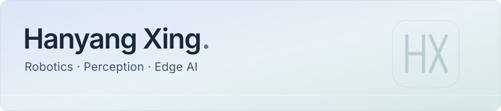

  <a href="https://harryxing213.github.io/"><b>Portfolio ↗</b></a>
  &nbsp; / &nbsp;
  <a href="https://www.linkedin.com/in/hanyangxing/">LinkedIn ↗</a>
  &nbsp; / &nbsp;
  <a href="mailto:hx2446@columbia.edu">Email ↗</a>

I'm an **M.S. student in Electrical Engineering at Columbia University**. I work with radar point clouds, embedded computer vision and learning algorithms, with an interest in how they perform in working systems.

> **Seeking Summer 2027 internships in robotics and perception.**

### From sensing to deployment

<table>
<tr>
<td width="50%" valign="top">
<h3>Vision on the edge</h3>

License plate detection and recognition on the Rockchip RV1106 camera platform.

YOLOv8 detection · CNN–TCN recognition · ONNX export · INT8 RKNN deployment

<a href="https://github.com/Harryxing213/License-Plate-Recognition-with-Edge-Model-Deployment"><b>Explore the project ↗</b></a>

</td>
<td width="50%" valign="top">
<h3>Radar for indoor sensing</h3>

Fall detection from ceiling-mounted mmWave radar point clouds.

MATLAB preprocessing · Temporal datasets · PointNet / PointNet++ · Experimental multi-person tracking

<a href="https://github.com/Harryxing213/Indoor-Fall-Detection-based-on-Millimeter-Wave-Radar"><b>Explore the project ↗</b></a>

</td>
</tr>
</table>

### On my workbench

**Measurement uncertainty** — Developing algorithms to adjust the variance assigned to different measurements in ROS 2 and Gazebo, with Python implementation.

**Learning on hardware** — Investigating the accuracy of reinforcement learning policies deployed on hardware, with ongoing work in ROS 2 and Python.

Both projects are in progress. Public code and details will be added when available.

### Tools I work with

**Programming** &nbsp; `Python` `C / C++` `MATLAB`  
**Perception & learning** &nbsp; `PyTorch` `OpenCV` `YOLOv8` `PointNet / PointNet++`  
**Robotics & deployment** &nbsp; `ROS 2` `Gazebo` `ONNX` `RKNN` `INT8 quantization`

Previously: dual bachelor's degrees at UESTC and the University of Glasgow. Expected M.S. graduation: December 2027. More project context and a printable CV are available on my <a href="https://harryxing213.github.io/">portfolio</a>.
